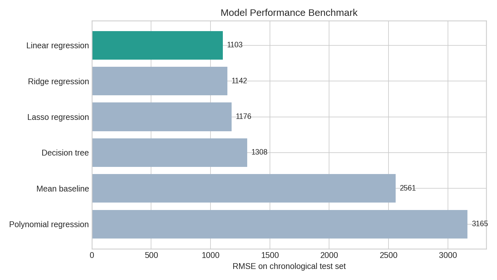
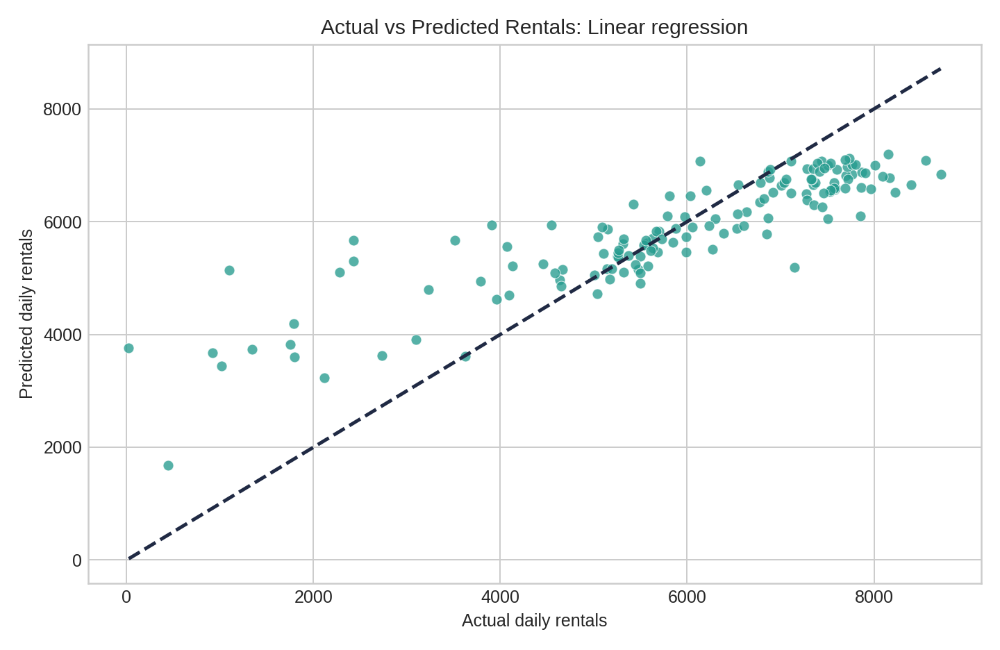
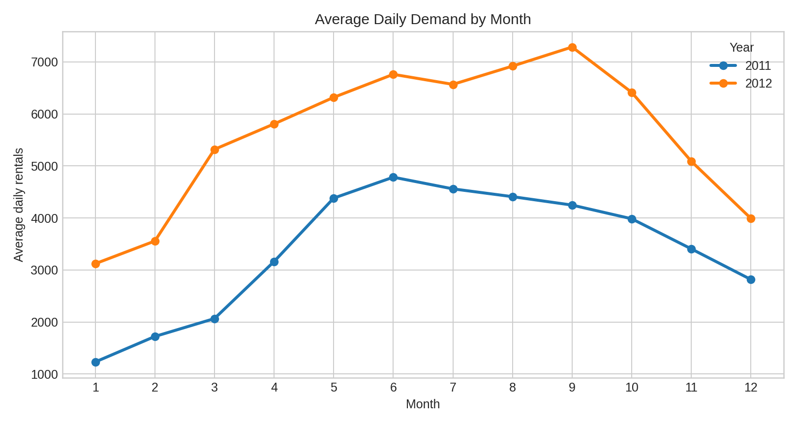
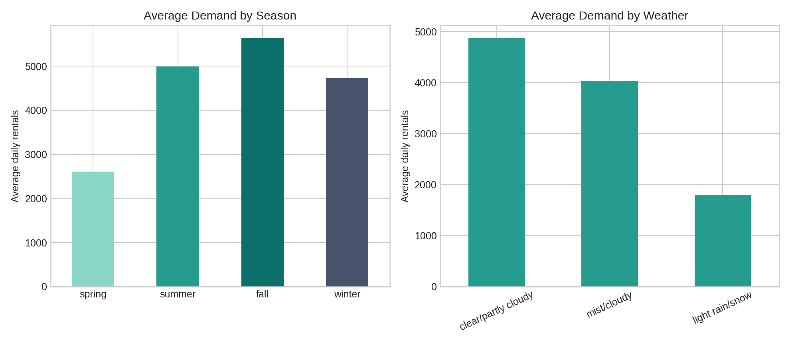

# Bike Sharing Demand Analytics

**Python · Data Analysis · Machine Learning · Regression · Data Visualization**

An end-to-end analysis of **daily bike rental demand in Washington, D.C.** using historical Capital Bikeshare data from 2011–2012. The project explores patterns in weather, calendar variables, and seasonality, and benchmarks interpretable regression models on a time-ordered holdout period.

> **Main result:** Linear regression achieved **R² = 0.654**, **MAE = 804 rentals**, and **RMSE = 1,103 rentals** on the chronological test set (2012-08-07 to 2012-12-31). These results describe performance on this historical test period, not current operational accuracy.



## Project goals

- Understand how weather, seasonality, and calendar features relate to bike rental activity.
- Identify typical daily and hourly demand patterns.
- Compare predictive models against a simple mean baseline, without leaking target components into the features.
- Create clear, reproducible visualizations and documented results.

## Dataset

The analysis uses the [UCI Bike Sharing dataset](https://archive.ics.uci.edu/dataset/275/bike+sharing+dataset):

| File | Records | Purpose |
| --- | ---: | --- |
| `data/raw/day.csv` | 731 daily observations | Descriptive analysis and predictive modeling |
| `data/raw/hour.csv` | 17,379 hourly observations | Analysis of hourly usage patterns |

- **Time span:** 2011-01-01 to 2012-12-31.
- **Prediction target:** `cnt` — total daily rentals.
- **Available features:** season, year, month, holiday/working day, weekday, weather category, temperature, apparent temperature, humidity, and wind speed.
- **Data validation:** no missing values were found; the `casual` and `registered` columns were excluded from model predictors because their sum equals `cnt` (target leakage).

Dataset usage and attribution details are in [data/README.md](data/README.md).

## Methods and evaluation

1. **Quality checks:** inspect missing values, duplicate records, target consistency and summary statistics.
2. **EDA:** visualize rental distributions, monthly patterns, weather effects, weekday/hourly behavior and correlation matrix.
3. **Preprocessing:** median imputation and scaling for numeric features; mode imputation and one-hot encoding for categorical features, fitted on the training set through scikit-learn pipelines.
4. **Chronological split:** 584 observations for training (80%); 147 for testing (20%), with the test period from **2012-08-07 to 2012-12-31**.
5. **Model comparison:** mean baseline, linear regression, polynomial regression, ridge, lasso, and a depth-limited decision tree. Models are ranked by test RMSE.

### Test-set performance

| Model | MAE (rentals) ↓ | RMSE (rentals) ↓ | R² ↑ |
| --- | ---: | ---: | ---: |
| Linear regression | 804 | 1,103 | 0.654 |
| Ridge regression | 884 | 1,142 | 0.629 |
| Lasso regression | 900 | 1,176 | 0.606 |
| Decision tree | 1,083 | 1,308 | 0.513 |
| Mean baseline | 2,290 | 2,561 | -0.866 |
| Polynomial regression | 1,000 | 3,165 | -1.851 |

The simple linear regression was the best-performing model for the recorded holdout period. The error metrics are expressed in rental counts. The generated JSON includes MAPE for completeness, but **MAPE is misleading here**, as some days have very low actual demand (the minimum daily count is **22**), inflating percentage errors.



## Selected insights

- Mean daily usage: **4,504 rentals**.
- Highest average month across the two-year dataset: **June**.
- Highest average hourly demand: **17:00**.
- Temperature and daily count show a **positive Pearson correlation (r = 0.63)**.





These patterns are descriptive associations. Neither correlations nor large model coefficients establish a causal effect. Coefficient magnitudes also depend on feature scaling and encoding, so the feature ranking is **model-specific**, not a universal importance measure.

## Reproduce the analysis

Requirements: **Python 3.10+**, a terminal, and JupyterLab.

Clone this repository or download it as a ZIP and extract the files. Open a terminal **in the repository root** (the directory containing this README and `requirements.txt`).

```bash
python -m venv .venv
```

Activate the virtual environment:

- **Windows (PowerShell):** `.\.venv\Scripts\Activate.ps1`
- **macOS / Linux:** `source .venv/bin/activate`

Then install dependencies and launch Jupyter:

```bash
python -m pip install --upgrade pip
python -m pip install -r requirements.txt
python -m jupyter lab
```

Open **`notebooks/bike_sharing_demand_analytics.ipynb`** and select **Run → Run All Cells**. The notebook saves plots (PNG and PDF) and a machine-readable summary (`figures/analysis_results.json`) to the `figures/` directory. The notebook also resolves data paths if launched from the `notebooks/` directory.

No external API or credentials are required; the necessary original dataset files are included.

## Repository structure

```text
bike-sharing-demand-analytics/
├── README.md
├── requirements.txt
├── .gitignore
├── data/
│   ├── README.md                 # Dataset credit and usage information
│   └── raw/                      # UCI files: day.csv, hour.csv, Readme.txt
├── notebooks/
│   └── bike_sharing_demand_analytics.ipynb
└── figures/
    ├── analysis_results.json
    ├── model_performance.png
    ├── actual_vs_predicted.png
    └── ...                       # Other generated charts in PNG/PDF
```

The Jupyter notebook contains the full executable analysis and generates the visualizations.

## Limitations and future work

- Data cover **2011–2012 only** and cannot be assumed to reflect current demand.
- Weather variables are observed historical values; a real deployment would need forecast weather information available *before* the predicted day.
- This is a fixed-parameter, one-split benchmark; rolling-origin validation and hyperparameter selection using training-only validation folds would improve reliability.
- Unobserved events, policy changes, and disruptions can strongly influence demand, but are not modeled explicitly.
- Feature correlations and coefficient magnitudes are not evidence of causation.

## Data attribution and licensing

- **Data source:** [UCI Machine Learning Repository — Bike Sharing](https://archive.ics.uci.edu/dataset/275/bike+sharing+dataset) (2013), [DOI: 10.24432/C5W894](https://doi.org/10.24432/C5W894).
- **Dataset license:** [CC BY 4.0](https://creativecommons.org/licenses/by/4.0/). Original attribution details are preserved in the accompanying `data/raw/Readme.txt`.

The dataset license applies to the data only. **No separate license has been assigned to the analysis code** in this portfolio version.
